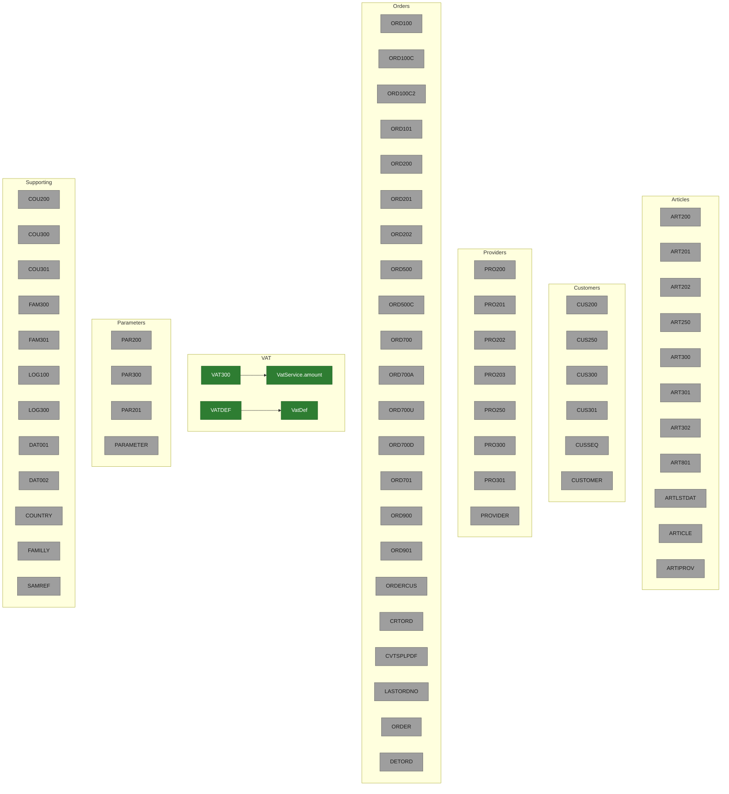

# Modernization map

Read of `ATU_SRC/`, `modern/` on `slice-a-vat`, and the branch tips `demo-base`, `slice-a-vat`, `slice-b-reorder`, and `cloud-orders`. Display files and logical files are not separate objects here. They are the screen or the access path of a program or physical file already named in [docs/inventory.md](inventory.md).

Colour: green is migrated and covered by passing tests in `modern/`. Amber is in progress on a branch. Grey is not started.

## Branches

| Branch | On `origin` | What it holds |
| --- | --- | --- |
| `demo-base` | yes | `docs/business-rules.md` and `docs/inventory.md`. No `modern/`. |
| `slice-a-vat` | yes | The VAT amount slice. Pull request https://github.com/oumaymaabida/atuMerlin/pull/11 (open, base `demo-base`). |
| `slice-b-reorder` | no | `git ls-remote --heads origin` has no such ref. Nothing is in progress for reorder. |
| `cloud-orders` | no | `git ls-remote --heads origin` has no such ref. Nothing is in progress for orders. |

No legacy object is amber. The two green objects are the only ones with a Java class and a passing test.

## Legacy objects

`progress` is declared and unused. `slice-b-reorder` and `cloud-orders` are not on the remote, so no object is in progress.

## Migrated rules

### VAT-01 — VAT amount

| | |
| --- | --- |
| Legacy | `ATU_SRC/QRPGLESRC/VAT300.RPGLE:46-47` (`tot = (net * vatrate) / 100`, then `%dech` to scale 2). Missing code is rate 0 at `:70-71`. `VATDEL` is not read. |
| Java | `com.atu.modern.vat.VatService.amount`. HTTP is `VatController` `GET /api/vat/{code}/amount`. The row is `VatDef` / `V2__VATDEF.sql`. |
| Test | `com.atu.modern.vat.VatAmountTest` |
| Golden vectors | 14 in `modern/src/test/resources/golden/vat-amount.csv`. One more test, not a CSV row, checks that a second read of the same code sees a changed rate (`VAT300.RPGLE:68-72`). |
| Status | Passing. `VatAmountTest` 16 tests, 0 failures, on `slice-a-vat`. |
| Branch / PR | `slice-a-vat` / https://github.com/oumaymaabida/atuMerlin/pull/11 |

`VAT-02`, `VAT-03`, and `VAT-04` in [docs/business-rules.md](business-rules.md) are not this slice. `ExistVATRate`, `GetVATRate`, and `GetVATDesc` have no endpoint. The last-record cache is not ported. Each call reads the current `VATDEF` row.

## Totals

| | Count |
| --- | --- |
| Legacy objects migrated / total | 2 / 67 |
| Documented rules covered by tests | 1 / 24 (`VAT-01` of the rules in `docs/business-rules.md`) |
| Suspected legacy bugs raised | 12, all open |

The 67 objects are the nodes above except `VatService.amount` and `VatDef`. The two migrated objects are `VAT300` and `VATDEF`.

The 12 questions are in [docs/business-rules.md](business-rules.md) under "Suspected legacy bugs". None has been answered or changed in `ATU_SRC/` or in `modern/`.

| # | Question | Status |
| --- | --- | --- |
| 1 | PRO202 and PRO203 propose `minimum + customer orders - purchase orders - stock`, which is not the `WHERE` gap. | Open |
| 2 | PRO203 requires `ARCUSQTY > 0`. PRO202 does not. | Open |
| 3 | ORD700 insert adds `ODQTY`. ART801 stores `ODQTY - ODQTYLIV`. | Open |
| 4 | Closing an order does not release `ARCUSQTY`. ART801 drops it only when another open line remains. | Open |
| 5 | ORD701 can move `CULASTORD` backward. ART801 uses `MAX(ORDATE)`. | Open |
| 6 | `CUCREDIT` changes only when ART801 runs. | Open |
| 7 | ORD200 option 2 is rejected on every order. | Open |
| 8 | ORD101 compares each new quantity with the other field's old value. | Open |
| 9 | ORD101 option 6 is labelled Deliver and has no action. | Open |
| 10 | Stock, credit, and reorder selection ignore `ARDEL`, `APDEL`, and `VATDEL`. | Open |
| 11 | `DETORD` is keyed with year. `DETORD1`, ART801, and ORDERCUS are not. | Open |
| 12 | Purchase file names use `*YMD`. `ORDATE` is `*ISO`. PRO202 hard-codes the buyer. | Open |
